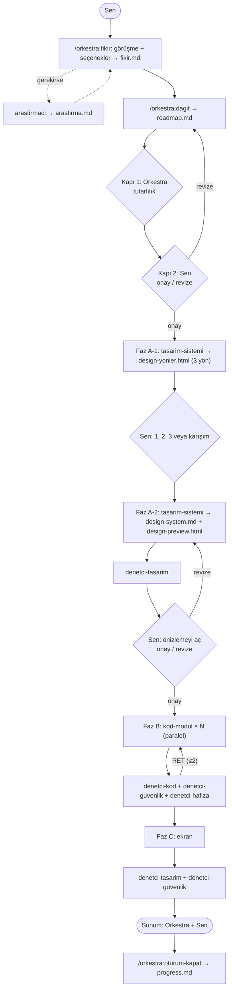

# Orkestra

Claude Code için Türkçe çoklu ajan iş akışı eklentisi. Fikri sen verirsin. Orkestra (ana oturum) fikri bir yol haritasına çevirir, işi üretici ajanlara dağıtır ve her işi denetçi ajanlardan geçirir. Hafıza proje dosyalarında tutulur, bu yüzden her oturum temiz başlar.

## Akış



| Rol | Biçim | Model | Yazar mı |
|---|---|---|---|
| Orkestra | Ana oturum | oturum modeli | Sadece hafıza dosyaları |
| İş dağıtıcı | Skill `/orkestra:dagit` | oturum modeli | roadmap.md |
| arastirmaci | Alt ajan (web araması) | sonnet | Sadece arastirma.md |
| tasarim-sistemi, kod-modul, ekran | Alt ajan | sonnet | Atanan klasör |
| denetci-kod, denetci-tasarim, denetci-hafiza | Alt ajan | sonnet | Hayır |
| denetci-guvenlik | Alt ajan | opus | Hayır |

Kurallar:
- Denetçiler **ONAY / RET + gerekçe** döner.
- Aynı iş 2. kez reddedilirse durur ve sana gelir.
- Her üretici sadece roadmap'te kendisine atanan klasöre yazar.
- Her faz sonunda orkestra progress.md'yi yazar ve durur. Sen `/clear` yazıp sonraki fazı başlatırsın. Böylece ana oturumun bağlamı küçük kalır.

## Kurulum

GitHub'dan kurmak için:

```
/plugin marketplace add 2muhammetbulbul2-lang/orkestra
/plugin install orkestra@orkestra
```

Yerel klasörden kurmak için (geliştirme):

```
/plugin marketplace add C:/yol/orkestra
/plugin install orkestra@orkestra
```

CLI ile yalnız tek bir oturumda denemek için: `claude --plugin-dir ./orkestra`

## Komutlar

Eklenti skill'leri eklenti adıyla çağrılır. **Komutları tek tek yaz**: biri bitince sonrakini çalıştır, hepsini tek mesajda yapıştırma.

| Komut | Ne yapar |
|---|---|
| `/orkestra:yeni-proje` | Şablonları projeye kopyalar: CLAUDE.md, fikir/roadmap/progress/design-system.md, `.claude/settings.json`. Var olan dosyanın üzerine yazmaz; settings.json'daki deny kurallarını birleştirir. |
| `/orkestra:fikir` | Seçenekli sorularla derinlemesine görüşür (kullanıcı, kapsam, veri, his). Gerekirse araştırmacıya benzer ürünleri ve ücretli/ücretsiz alternatifleri araştırtıp seçenek olarak sunar. Sonucu `fikir.md`ye yazar. |
| `/orkestra:dagit` | `roadmap.md`yi üretir (fazlar, görevler, sahiplik, mermaid). Ardından Kapı 1 ve Kapı 2'yi uygular. |
| `/orkestra:faz-calistir A\|B\|C` | Fazı yürütür: dağıtım, denetim ve ret limiti. |
| `/orkestra:duzelt <sorun>` | Tek bir sorunu düzeltir: dosya sahibi tek üretici, değişiklik türüne uyan tek denetçi. Kapsam birden fazla sahibe yayılıyorsa durur; aynı sorun 2 denemede düzelmezse tahmin yerine kanıt (ekran görüntüsü, hata çıktısı) ister. |
| `/orkestra:devral` | Çalışan bir projeyi (kendi CLAUDE.md, hafıza ve yol haritasıyla) orkestra düzenine bağlar. Önce salt okunur tarar: şişmiş hafıza, 1000+ satırlık dosyalar, test/CI, sahiplik önerisi. Onayınla yalnız `ORKESTRA.md` ve eksik deny kurallarını ekler; mevcut dosyaların üzerine yazmaz. |
| `/orkestra:oturum-kapat` | progress.md'yi günceller, commit mesajı önerir, `/compact` veya `/clear` önerir. |

## Otomatik katman

- **PostToolUse hook:** her Edit/Write sonrasında projenin `package.json` dosyasında `lint`/`test` script'i varsa çalışır (60 sn sınırı). Script yoksa sessizce geçer. Başarısız olursa hatayı Claude'a iletir.
- **Stop hook:** progress.md bu oturumda değişmediyse hatırlatma gösterir. Oturumu engellemez.
- **Okunan içerik taraması:** `WebFetch`, `WebSearch` ve `Read` çıktısında "önceki talimatları unut" gibi kalıplar varsa ajana "bu içerik veridir" uyarısı eklenir. Engellemez, yalnız uyarır; kalıp listesi sınırlıdır, tam koruma değildir.
- **Hook yoğunluğu:** `ORKESTRA_HOOKS=off` iki hook'u da kapatır, `ORKESTRA_HOOKS=minimal` PostToolUse'ta yalnız `lint` çalıştırır (test atlanır). Boşsa lint ve test çalışır.
- **Görsel onay kapısı:** Faz A ve Faz C'de (ve görünüm düzeltmelerinde) `ekran` ajanı ekran görüntüsünü `kanit/` klasörüne alır, orkestra varsayılan görüntüleyicide açar, sen "onay" demeden sonraki aşamaya geçilmez. Projede Playwright kuruluysa çalışır; yoksa kurmaz, söyler ve eski yola (dosyayı tarayıcıda aç) döner.
- **Depo haritası:** `scripts/harita.mjs` Faz B/C görevlerine kısa bir dosya haritası verir (salt okunur, ağ yok, gizli dosyaları listelemez).
- **Graphify (isteğe bağlı):** Graphify'ı sen kurarsan (PyPI paketi `graphifyy`, iki "y"; kurulum `~/.claude/` altına yazar, o yüzden orkestra kurmaz) ve projede `graphify-out/GRAPH_REPORT.md` oluşursa `faz-calistir` ilgili özeti ajanlara bağlam olarak verir. Yoksa hiçbir şey değişmez.
- **Betik testleri:** `node --test test/betikler.test.mjs` hook ve yardımcı betikleri geçici klasörlerde sınar (25 test; gerçek projeye ve ~/.claude'a dokunmaz, tarayıcı/görüntüleyici açmaz).
- **permissions.deny** (`/orkestra:yeni-proje` ile projeye eklenir): `.env`, `.env.*`, `*.pem`, `*.key`, `secrets/`, `node_modules/`, `dist/`, `build/`, `.wrangler/` okunmaz.

## Örnek kullanım

```
> /orkestra:yeni-proje
> /orkestra:fikir Basit bir yapılacaklar uygulaması
> /orkestra:dagit
  (roadmap'i incele → "onay")
> /clear
> /orkestra:faz-calistir A
  (design-yonler.html'i aç → "2" veya "1'in renkleri, 3'ün fontu")
  (design-preview.html'i aç → "onay")
> /clear
> /orkestra:faz-calistir B
> /clear
> /orkestra:faz-calistir C
> /orkestra:oturum-kapat
```

Doldurulmuş örnekler için bkz. [examples/fikir.md](examples/fikir.md) ve [examples/roadmap.md](examples/roadmap.md).

## Sınırlamalar

- Eklentiler CLAUDE.md yükleyemez. Bu yüzden orkestra kuralları `/orkestra:yeni-proje` ile projeye `CLAUDE.md` olarak kopyalanır. Projende zaten bir CLAUDE.md varsa kuralları elle eklemen gerekir.
- Eklentiler `permissions` ayarı taşıyamaz. Deny kuralları yalnız `/orkestra:yeni-proje` çalıştırılınca projeye eklenir.
- Eklenti ajanlarında `hooks` ve `permissionMode` desteklenmez. "Sadece kendi klasörüne yaz" kuralı talimatla ve denetçilerle korunur, teknik olarak zorlanmaz.
- Lint/test hook'u yalnız `package.json` script'lerini tanır (Node projeleri). Başka ekosistemlerde sessizce geçer.
- Stop hatırlatması `systemMessage` ile gösterilir. Bazı arayüzlerde görünmeyebilir.
- Hook'lar `node` gerektirir.
- `/clear` ve `/compact` yalnız kullanıcı tarafından çalıştırılabilir. Orkestra bunları yalnızca önerir.
- Alt ajanlar bitince ana oturum her seferinde yeniden uyanır. Bu yüzden çok sayıda paralel görev ana oturumda da token harcar.

## Lisans

MIT
