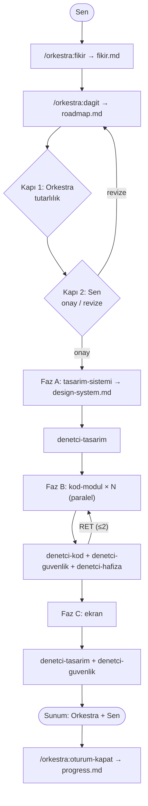

# Orkestra

Claude Code için Türkçe çoklu ajan iş akışı eklentisi. Fikri sen verirsin. Orkestra (ana oturum) fikri bir yol haritasına çevirir, işi üretici ajanlara dağıtır ve her işi denetçi ajanlardan geçirir. Hafıza proje dosyalarında tutulur, bu yüzden her oturum temiz başlar.

## Akış



| Rol | Biçim | Model | Yazar mı |
|---|---|---|---|
| Orkestra | Ana oturum | oturum modeli | Sadece hafıza dosyaları |
| İş dağıtıcı | Skill `/orkestra:dagit` | oturum modeli | roadmap.md |
| tasarim-sistemi, kod-modul, ekran | Alt ajan | sonnet | Atanan klasör |
| denetci-kod, denetci-tasarim, denetci-hafiza | Alt ajan | sonnet | Hayır |
| denetci-guvenlik | Alt ajan | opus | Hayır |

Kurallar:
- Denetçiler **ONAY / RET + gerekçe** döner.
- Aynı iş 2. kez reddedilirse durur ve sana gelir.
- Her üretici sadece roadmap'te kendisine atanan klasöre yazar.

## Kurulum

GitHub'dan kurmak için:

```
/plugin marketplace add 2muhammetbulbul2-lang/orkestra
/plugin install orkestra@orkestra
```

Yerel klasörden kurmak için (geliştirme):

```
/plugin marketplace add C:/yol/orkestra
/plugin install orkestra@orkestra
```

CLI ile yalnız tek bir oturumda denemek için: `claude --plugin-dir ./orkestra`

## Komutlar

Eklenti skill'leri eklenti adıyla çağrılır:

| Komut | Ne yapar |
|---|---|
| `/orkestra:yeni-proje` | Şablonları projeye kopyalar: CLAUDE.md, fikir/roadmap/progress/design-system.md, `.claude/settings.json`. Var olan dosyanın üzerine yazmaz; settings.json'daki deny kurallarını birleştirir. |
| `/orkestra:fikir` | Hayal, amaç, kullanıcı, kısıtlar ve başarı ölçütünü netleştirir. Sonucu `fikir.md`ye yazar. |
| `/orkestra:dagit` | `roadmap.md`yi üretir (fazlar, görevler, sahiplik, mermaid). Ardından Kapı 1 ve Kapı 2'yi uygular. |
| `/orkestra:faz-calistir A\|B\|C` | Fazı yürütür: dağıtım, denetim ve ret limiti. |
| `/orkestra:oturum-kapat` | progress.md'yi günceller, commit mesajı önerir, `/compact` veya `/clear` önerir. |

## Otomatik katman

- **PostToolUse hook:** her Edit/Write sonrasında projenin `package.json` dosyasında `lint`/`test` script'i varsa çalışır (60 sn sınırı). Script yoksa sessizce geçer. Başarısız olursa hatayı Claude'a iletir.
- **Stop hook:** progress.md bu oturumda değişmediyse hatırlatma gösterir. Oturumu engellemez.
- **permissions.deny** (`/orkestra:yeni-proje` ile projeye eklenir): `.env`, `.env.*`, `*.pem`, `*.key`, `secrets/`, `node_modules/`, `dist/`, `build/`, `.wrangler/` okunmaz.

## Örnek kullanım

```
> /orkestra:yeni-proje
> /orkestra:fikir Basit bir yapılacaklar uygulaması
> /orkestra:dagit
  (roadmap'i incele → "onay")
> /orkestra:faz-calistir A
> /orkestra:faz-calistir B
> /orkestra:faz-calistir C
> /orkestra:oturum-kapat
```

Doldurulmuş örnekler için bkz. [examples/fikir.md](examples/fikir.md) ve [examples/roadmap.md](examples/roadmap.md).

## Sınırlamalar

- Eklentiler CLAUDE.md yükleyemez. Bu yüzden orkestra kuralları `/orkestra:yeni-proje` ile projeye `CLAUDE.md` olarak kopyalanır. Projende zaten bir CLAUDE.md varsa kuralları elle eklemen gerekir.
- Eklentiler `permissions` ayarı taşıyamaz. Deny kuralları yalnız `/orkestra:yeni-proje` çalıştırılınca projeye eklenir.
- Eklenti ajanlarında `hooks` ve `permissionMode` desteklenmez. "Sadece kendi klasörüne yaz" kuralı talimatla ve denetçilerle korunur, teknik olarak zorlanmaz.
- Lint/test hook'u yalnız `package.json` script'lerini tanır (Node projeleri). Başka ekosistemlerde sessizce geçer.
- Stop hatırlatması `systemMessage` ile gösterilir. Bazı arayüzlerde görünmeyebilir.
- Hook'lar `node` gerektirir.

## Lisans

MIT
