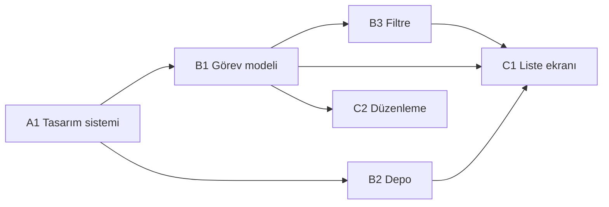

# Roadmap

> Kaynak: fikir.md · Durum: ONAYLI · Sürüm: 1

## Fazlar
- **A — Tasarım sistemi:** 3 yön seçimi (design-yonler.html) → design-system.md + design-preview.html (görsel onay)
- **B — Kod modülleri:** paralel, her modül kendi klasöründe
- **C — Ekranlar:** design-system.md'ye uyan arayüz

## Görevler
| ID | Faz | Görev | Bitti ölçütü | Ajan | Sahip klasör / dosya | Bağımlılık | Denetçiler |
|---|---|---|---|---|---|---|---|
| A1 | A | Tasarım sistemi (açık/koyu tema) + önizleme | (R2) Açık ve koyu temada tüm renk tokenları tanımlı; `design-preview.html` her bileşeni iki temada gösterir | tasarim-sistemi | `design-system.md`, `design-preview.html`, `design-yonler.html` | — | denetci-tasarim |
| B1 | B | Görev modeli + CRUD | (R1) `npm test` içinde ekle/düzenle/sil/tamamla testleri geçer; boş başlık reddedilir | kod-modul | `src/todos/**` | A1 | denetci-kod, denetci-guvenlik, denetci-hafiza |
| B2 | B | localStorage deposu | (R1) Kaydedilen görevler yeniden yüklemede aynen döner; bozuk JSON'da uygulama boş listeyle açılır (test var) | kod-modul | `src/storage/**` | A1 | denetci-kod, denetci-guvenlik, denetci-hafiza |
| B3 | B | Filtreleme | (R1) "tamamlanan / bekleyen / hepsi" filtreleri doğru alt kümeyi döndürür (test var) | kod-modul | `src/filters/**` | B1 | denetci-kod, denetci-hafiza |
| C1 | C | Liste ekranı | (R1) Görev eklenince listede görünür, sayfa yenilenince kalır. Doğrulama: kullanıcı tarayıcıda dener | ekran | `src/screens/list/**` | A1, B1, B2, B3 | denetci-tasarim, denetci-guvenlik |
| C2 | C | Görev düzenleme diyaloğu | (R1) Başlık değiştirilip kaydedilince listede yeni başlık görünür; Esc diyaloğu kapatır. Doğrulama: kullanıcı tarayıcıda dener | ekran | `src/screens/edit/**` | A1, B1 | denetci-tasarim, denetci-guvenlik |

## Paralel çalışma
- Paralel grup B: B1 ve B2 paralel çalışır, B3 B1'den sonra başlar.
- Çakışma / sıralama notu: `src/main.ts` sadece C1'e aittir. Diğer görevler bu dosyaya dokunmaz.

## Diyagram

## Kapı kayıtları
- Kapı 1 (orkestra): 3 temel özellik → B1, B2, B3 ve C1, C2 görevleri. Sahiplik çakışması yok. ✔
- Kapı 2 (kullanıcı): onay.
