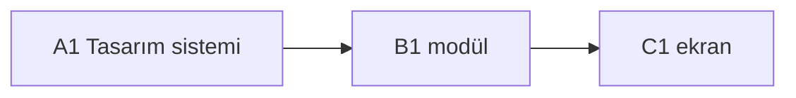

# Roadmap

> Kaynak: fikir.md · Durum: TASLAK | ONAYLI · Sürüm: 1

## Fazlar
- **A — Tasarım sistemi:** 3 yön seçimi (design-yonler.html) → design-system.md + design-preview.html (görsel onay)
- **B — Kod modülleri:** paralel, her modül kendi klasöründe
- **C — Ekranlar:** design-system.md'ye uyan arayüz

## Görevler
| ID | Faz | Görev | Bitti ölçütü | Ajan | Sahip klasör / dosya | Bağımlılık | Denetçiler |
|---|---|---|---|---|---|---|---|
| A1 | A | Tasarım sistemi + önizleme | (ör. 3 temada tüm tokenlar tanımlı; önizleme her bileşeni gösterir) | tasarim-sistemi | `design-system.md`, `design-preview.html`, `design-yonler.html` | — | denetci-tasarim |
| B0 | B | Proje iskeleti (package.json, test komutu, .gitignore) | (ör. `npm test` hatasız çalışır) | kod-modul | `package.json`, `.gitignore` | A1 | denetci-kod |
| B1 | B | (modül) | (ör. `npm test` içinde şu 3 davranış test edilir ve geçer) | kod-modul | `src/(modul)/**` | B0 | denetci-kod, denetci-guvenlik, denetci-hafiza |
| C1 | C | (ekran) | (ör. şu eylem yapılınca ekranda şu görünür) | ekran | `src/screens/(ekran)/**` | A1, B1 | denetci-tasarim, denetci-guvenlik |

> **Bitti ölçütü** her görevde zorunlu, tek cümle ve doğrulanabilir: bir komutun çıktısı, bir davranış veya ekranda görünen bir şey. "Düzgün çalışır", "tamamlandı" ölçüt değildir. Ölçüt, hangi gereksinimi (fikir.md R1, R2...) karşıladığını başında belirtir: "(R2) ...". Gereksinimle ilgisi olmayan görev (iskelet gibi) "(R-)" yazar. Üretici raporunda ölçüt için kanıt (komut veya gözlem → sonuç) verir, denetçi ölçütün karşılandığına bakar. Doğrulanamayan ölçüt yazılırsa "Doğrulama:" ile kim nasıl bakacak belirtilir (örn. "kullanıcı tarayıcıda açar").

## Tasarım gerektiren görevler (Faz B, kod yazılmadan önce `tasarim/<ID>.md`)
- (ID — neden: dış servis/ücret, kullanıcı verisi, güvenlik/yetki, geri alınamaz işlem, 3+ görevin bağlı olduğu çekirdek, belirsiz teknik seçim. Yoksa "yok".)

## Paralel çalışma
- Paralel grup B: (bağımsız B görevleri)
- Çakışma / sıralama notu: (aynı dosyaya dokunan görevler ve çözüm: sırala | worktree)

## Diyagram

## Kapı kayıtları
- Kapı 1 (orkestra): —
- Kapı 2 (kullanıcı): —
