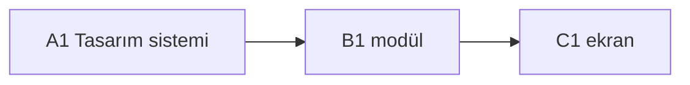

# Roadmap

> Kaynak: fikir.md · Durum: TASLAK | ONAYLI · Sürüm: 1

## Fazlar
- **A — Tasarım sistemi:** design-system.md + design-preview.html (görsel onay)
- **B — Kod modülleri:** paralel, her modül kendi klasöründe
- **C — Ekranlar:** design-system.md'ye uyan arayüz

## Görevler
| ID | Faz | Görev | Ajan | Sahip klasör / dosya | Bağımlılık | Denetçiler |
|---|---|---|---|---|---|---|
| A1 | A | Tasarım sistemi + önizleme | tasarim-sistemi | `design-system.md`, `design-preview.html` | — | denetci-tasarim |
| B1 | B | (modül) | kod-modul | `src/(modul)/**` | A1 | denetci-kod, denetci-guvenlik, denetci-hafiza |
| C1 | C | (ekran) | ekran | `src/screens/(ekran)/**` | A1, B1 | denetci-tasarim, denetci-guvenlik |

## Paralel çalışma
- Paralel grup B: (bağımsız B görevleri)
- Çakışma / sıralama notu: (aynı dosyaya dokunan görevler ve çözüm: sırala | worktree)

## Diyagram

## Kapı kayıtları
- Kapı 1 (orkestra): —
- Kapı 2 (kullanıcı): —
